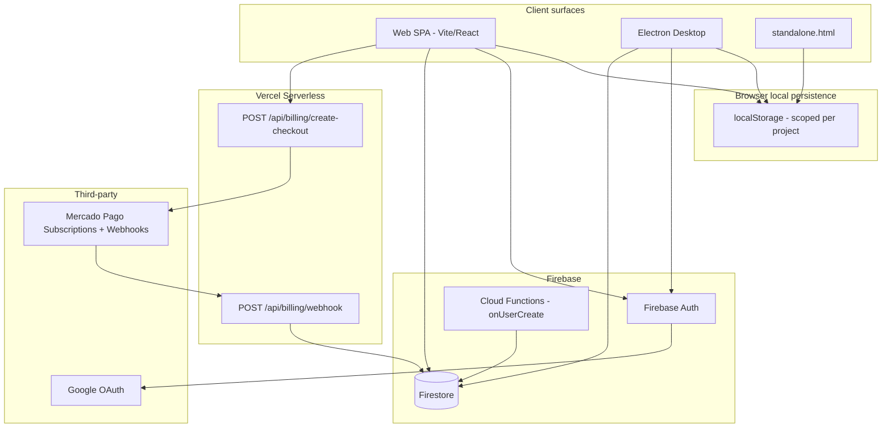
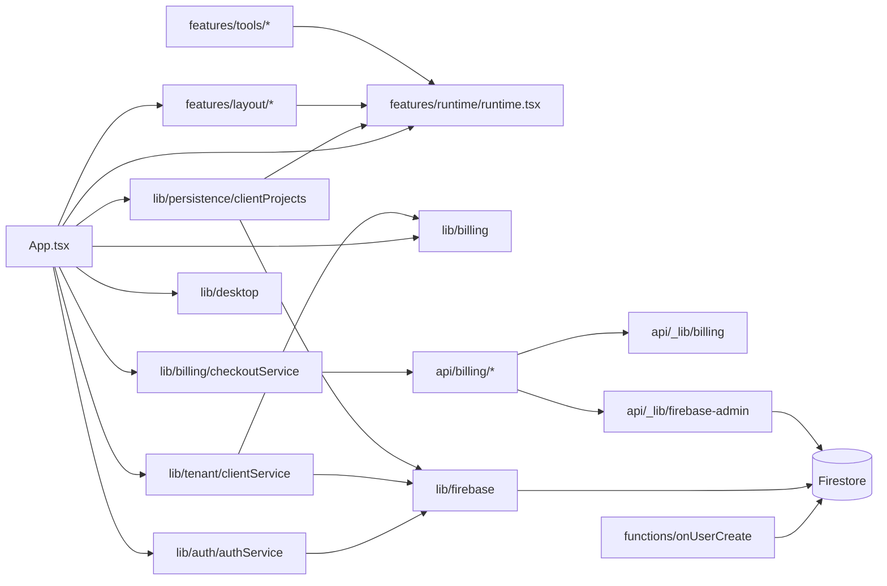

# Curv App — Project Status

**Audit date:** 2026-07-09
**Firestore sync update:** 2026-07-26
**Latest repository review:** 2026-10-09
**Latest readiness assessment:** primera semana de octubre de 2026; actualizada el 2026-10-10
**Latest value-model / Peru market analysis:** 2026-10-01
**Auditor role:** Technical / Studio OS readiness review
**Repository:** `curv-app` v0.0.0

---

## Actualizacion de producto — 2026-10-10 (Lima): cierre hacia Beta

Fuente: validaciones y decisiones comunicadas por el product owner en esta fecha. Se registran como validacion reportada; esta actualizacion documental no constituye una nueva ejecucion de QA ni una auditoria de produccion. La evaluacion de octubre siguiente sustituye el 5,3/10 de agosto como lectura vigente; agosto se conserva como linea base historica.

### Evaluacion de preparacion — primera semana de octubre de 2026

**Periodo de referencia solicitado:** 1 al 7 de octubre. **Fecha de elaboracion:** 10 de octubre. Esta es una evaluacion retrospectiva actualizada con el estado documentado el 9 de octubre y las confirmaciones del product owner del 10 de octubre; no atribuye esas confirmaciones ni todos los avances a una fecha anterior. No hay evidencia suficiente para reconstruir una nota estrictamente al cierre del 7 de octubre.

Metodo: juicio de preparacion sobre las seis dimensiones del scorecard existente, en escala de 0 a 10. Las notas son estimaciones razonadas, no porcentajes de tareas completadas ni resultados de una nueva auditoria. El indicador global usa la media simple, con igual peso por dimension, redondeada a un decimal: 43 / 6 = **7,2/10**. Una nota alta en otras areas no compensa una puerta critica pendiente.

| Dimension | Agosto | Octubre actualizado | Fundamento y limite |
|---|---:|---:|---|
| Cobertura funcional | 8/10 | **8/10** | Nueve herramientas disponibles y recorridos validados por el product owner. Se conserva la nota: validar no amplia la cobertura; Tramitologia sigue siendo futura. |
| Coherencia de experiencia | 6/10 | **8/10** | Interfaz alineada con el sistema visual y dashboard mejorado. Quedan branding de Curva Arquitectura y personalizacion de Identidad. |
| Continuidad de datos | 5/10 | **6/10** | Snapshots, conflictos, recuperacion y pruebas locales documentados. La comprobacion con dos sesiones sigue pendiente y limita la nota. |
| Seguridad y permisos | 6/10 | **7/10** | Permisos y aislamiento validados por el product owner; pruebas de reglas e invitaciones documentadas. El recorrido comercial pago → estudio → acceso sigue sin confirmacion en este intercambio. |
| Publicacion y calidad | 3/10 | **6/10** | CI y Preview de la PR documental #32 pasaron segun el cierre del chat de trabajo; hay matrices y pruebas locales. Falta cerrar aceptacion, rendimiento y promocion/comprobacion de la version validada. |
| Capacidad de evolucion | 4/10 | **8/10** | Las nueve herramientas tienen limites modulares y runtime.tsx queda como fachada de 99 lineas segun la revision del 9 de octubre. Persisten compatibilidad legacy y aceptacion de regresion desplegada. |
| **Preparacion global** | **5,3/10** | **7,2/10** | **Pre-Beta avanzada; salida a Beta cerrada condicionada a las puertas pendientes.** |

La diferencia de 1,9 puntos expresa esta reevaluacion; no es una medicion experimental de mejora. El indicador de **captacion de fundadores es 50% (5/10)** y se mantiene separado de la preparacion tecnica. La referencia de agosto no documenta una formula de agregacion; no se presume comparabilidad matematica exacta con la media explicitada aqui.

### Puertas de salida a Beta

| Puerta | Estado actualizado | Pendiente |
|---|---|---|
| 1. Recorridos de las nueve herramientas | Validada por el product owner | Conservar la evidencia y referencia de version para el cierre de release. |
| 2. Sincronizacion, conflictos y recuperacion con dos sesiones | Pendiente | Cierre previsto por el product owner para la semana del 12 al 18 de octubre de 2026; aun no ejecutado ni cerrado en este registro. |
| 3. Permisos y aislamiento de acceso | Validada por el product owner | Conservar la evidencia y referencia de version para el cierre de release. |
| 4. Oferta y recorrido comercial | Precios mensuales definidos | La definicion de precios no confirma por si sola la configuracion de Mercado Pago ni la validacion pago → estudio → acceso, cancelacion y reintentos. |
| 5. Preparacion y publicacion final | Pendiente | Retirar el branding de Curva Arquitectura del Dashboard, retocar las opciones de personalizacion de la ventana Identidad y completar la publicacion de la version validada. |

La captura aportada muestra la marca CURVA en el encabezado del Dashboard. El alcance exacto de los retoques de Identidad todavia debe concretarse; no se presume un reemplazo de marca ni nuevas opciones especificas. Los pendientes previos de rendimiento, trazabilidad, recuperacion y comprobacion breve en produccion conservan su estado hasta aportar su cierre.

### Estudios fundadores y oferta aprobada

- **Captacion:** 5/10 estudios fundadores, 50% de la meta; tres incorporaciones nuevas reportadas y cinco plazas por completar. No equivale a cinco cuentas pagadas o de uso recurrente confirmado.
- **Fundadores:** S/ 29 al mes para los diez primeros estudios. Duracion del beneficio, plan incluido e impuestos no especificados en esta decision.
- **BASE regular:** S/ 59,90 al mes despues de las primeras diez plazas.
- **PRO:** S/ 89,90 al mes.
- **Ampliacion prevista de PRO:** una familia de herramientas de **Tramitologia**, con notificaciones a partir de un calendario. Es alcance futuro; no se registra como funcionalidad implementada ni como requisito de la Beta BASE.

Esta decision de precios sustituye las alternativas historicas de precio del analisis del 1 de octubre para la oferta vigente. Queda pendiente reflejarla de manera consistente en landing, oferta comercial y planes del proveedor de pagos, y revisar las proyecciones economicas basadas en precios anteriores.

**Lectura actual:** dos puertas validadas por el product owner, una pendiente de sincronizacion con cierre previsto la proxima semana, oferta mensual definida con recorrido de pago aun sin confirmacion en este intercambio y preparacion final de marca/personalizacion/publicacion pendiente. No se calcula un porcentaje global de complecion a partir de estas puertas, porque tienen pesos y alcances distintos.

## Estado documentado — 2026-10-09 (Lima): Fase 4 en validacion

El registro siguiente conserva la revision del 9 de octubre. Para las puertas 1 y 3 y la decision de precios, prevalece la actualizacion del product owner del 10 de octubre anterior.

- `origin/master` esta en `0b229ff`: [PR #29](https://github.com/arquitecturacurva-sudo/MUArq/pull/29), [PR #30](https://github.com/arquitecturacurva-sudo/MUArq/pull/30) y [PR #31](https://github.com/arquitecturacurva-sudo/MUArq/pull/31) estan fusionadas. Esto confirma codigo en `master`, no una promocion verificada a produccion.
- Las nueve herramientas ya tienen limites de feature/aplicacion/infraestructura/dominio. `runtime.tsx` conserva los 239 exports historicos como fachada de compatibilidad de 99 lineas; su eliminacion sigue reservada para otro PR. No se cambiaron las claves legacy de localStorage ni el contrato de `ProjectSnapshot` en este pase.
- La PR #29 incorporo la matriz de regresion de nueve herramientas, pruebas de reglas y de invitaciones en emulador, migracion inicial de consumidores de la fachada, medicion reproducible del build y una presentacion de documentos legible para Viewer. Las pruebas locales documentadas pasan, pero no sustituyen la aceptacion autenticada ni demuestran que las reglas desplegadas coincidan con el repositorio.
- Las PR #30 y #31 alinearon la interfaz general con el sistema visual aprobado y centraron el dashboard en pantallas anchas. La identidad de los documentos conserva contraste legible. La demo local de congruencia visual no equivale a una prueba con datos reales.
- **Fase 4 abierta:** falta completar en un Preview identificado la [matriz de edicion, recarga, cambio de proyecto, restauracion y exportacion](qa/2026-07-26-firestore-snapshot-sync.md) para las nueve herramientas; la sincronizacion, conflictos y recuperacion offline con dos sesiones; y las [denegaciones del backend](qa/2026-10-07-phase-4-access-evidence.md) para Viewer sin asignacion y usuario ajeno. Tambien faltan la revision de reglas desplegadas, los [tiempos de navegador](qa/2026-10-07-phase-4-performance-baseline.md), la promocion del mismo artefacto probado y una comprobacion breve en produccion con proyecto QA desechable. No se deben usar proyectos de clientes. Un fallo de integridad o autorizacion bloquea el cierre.
- Siguiente paso: ejecutar y registrar las celdas pendientes en la [puerta de aceptacion de Fase 4](qa/2026-10-07-phase-4-integration-preview.md), corregir primero cualquier perdida de datos o acceso indebido, y solo entonces decidir el cierre de la fase.

## Modelo de valor y mercado peruano — 2026-10-01

**Decisión recomendada:** validar Curv como un workspace comercial-técnico para estudios pequeños de arquitectura e interiorismo que cotizan y, especialmente, también ejecutan obra. Priorizar un piloto asistido en Lima con proyectos reales. El producto tiene una propuesta de valor plausible; **demanda pagada, retención y rentabilidad todavía no están demostradas** con la evidencia revisada.

**Posicionamiento:** «Curv ayuda a tu estudio a preparar propuestas, ordenar alcances y documentar valorizaciones y cambios desde una misma ficha de proyecto». La promesa comercial es reducir trabajo repetido y proteger margen mediante documentación consistente. El concepto Studio OS sigue siendo una dirección de producto. En este analisis del 1 de octubre se conservaba el 5,3/10 de agosto; la evaluacion actualizada del 10 de octubre, al inicio del documento, lo sustituye por 7,2/10 como estimacion vigente de preparacion.

### 1. Repo / skills seleccionados y método

Se compararon tres opciones públicas por ajuste al encargo, claridad del método, exigencia de evidencia y facilidad de aplicación a este repositorio. “Mejor” significa mejor ajuste entre las opciones revisadas, no una clasificación exhaustiva del ecosistema.

| Opción | Ajuste y decisión |
|---|---|
| [shawnpang/startup-founder-skills](https://github.com/shawnpang/startup-founder-skills) | **Seleccionado.** Skills concretas para dimensionar mercado y comparar alternativas; formato útil para decisiones de producto. Licencia [MIT](https://github.com/shawnpang/startup-founder-skills/blob/main/LICENSE) verificada. |
| [xcrrr/claude-skills — market-researcher](https://github.com/xcrrr/claude-skills/blob/main/skills/business/market-researcher/SKILL.md) | Alternativa útil para investigación y segmentación; su alcance excluye modelos financieros detallados. |
| [FUY25/analyzing-business-strategy-skill](https://github.com/FUY25/analyzing-business-strategy-skill/blob/main/SKILL.md) | Cobertura estratégica amplia, pero una orquestación y un proceso de entregables considerablemente mayores que lo necesario para actualizar este status. |

Se aplicaron [market-research](https://github.com/shawnpang/startup-founder-skills/blob/main/skills/market-research/SKILL.md) y [competitive-analysis](https://github.com/shawnpang/startup-founder-skills/blob/main/skills/competitive-analysis/SKILL.md) mediante lectura de sus instrucciones, sin instalar paquetes ni ejecutar código externo. El análisis combina revisión del producto, fuentes públicas peruanas, alternativas comerciales y escenarios explícitos. El contexto de startup se obtuvo del repositorio. Se añadió un canvas de negocio para conectar creación, entrega y captura de valor.

**Convención de evidencia:** “observado” identifica código/documentos locales; “fuente” identifica información externa; “hipótesis” identifica una inferencia o supuesto pendiente. No se consultaron datos privados de ventas ni analítica productiva. No se realizaron entrevistas, pruebas de competidores ni una nueva auditoría técnica desplegada.

### 2. Qué valor puede entregar la app hoy

**Observado:** el registro `DEFAULT_TOOLS` de [`runtime.tsx`](../src/features/runtime/runtime.tsx) contiene nueve herramientas: honorarios, entregables, exclusiones, cronograma por etapas, cotización de obra, cronograma de obra, valorización, programa arquitectónico y orden de cambio. La ficha compartida, los documentos con marca del estudio y la importación PDF con revisión permiten una entrada comercial concreta.

| Trabajo del comprador | Dolor a validar en Perú | Mecanismo de valor en Curv | Evidencia que falta |
|---|---|---|---|
| Presentar una propuesta profesional | Repetir cliente, código, alcance y montos en diferentes archivos | Ficha compartida + honorarios + entregables + exclusiones + PDF | Tiempo real ahorrado y errores evitados frente al proceso previo |
| Cotizar una remodelación o local comercial | Transcribir presupuestos de proveedores y revisar partidas | Lectura de PDF/OCR con revisión antes de importar | Precisión con PDFs reales y tiempo total incluyendo correcciones |
| Controlar alcance y adicionales | Aceptar cambios sin documentar costo y plazo | Exclusiones y órdenes de cambio vinculadas al proyecto | Cambios efectivamente aprobados y cobrados, sin atribuir causalidad automáticamente |
| Sustentar avance y cobro | Preparar valorizaciones con información dispersa | Cotización, cronograma y valorización en el mismo contexto | Concordancia con contrato, aprobación del cliente y cobro efectivo |

La conexión comprobada es de identidad y contexto de proyecto; no implica que todos los cálculos se actualicen entre herramientas automáticamente. Exportar una valorización tampoco equivale a cobrarla. La app puede apoyar una conversación contractual, pero la aprobación, firma y pago deben verificarse fuera del PDF.

**Hipótesis central:** el estudio paga cuando el ahorro repetido y/o el margen recuperado superan el costo de suscripción, aprendizaje y migración. La estética ayuda a vender; la continuidad de datos sostiene la renovación. Las plantillas y el OCR son replicables: la ventaja potencial debe construirse con flujos confiables, casos peruanos, onboarding y distribución especializada.

### 3. Ubicación en el mercado peruano

El [CAP informó en febrero de 2026 que reúne a más de 35 mil arquitectos](https://cap.org.pe/2026/02/18/juramento-el-consejo-nacional-del-colegio-de-arquitectos-del-peru-para-el-periodo-2026-2029/). Es una referencia del universo profesional, **no un conteo de estudios compradores**, profesionales habilitados activos o suscriptores potenciales.

[PRODUCE reportó 2.346.592 empresas formales al cierre de 2024, de las cuales 99,1% eran micro y pequeñas empresas](https://www.gob.pe/institucion/produce/noticias/1168972-produce-peru-cerro-el-2024-con-2-34-millones-de-empresas-formales). Esto da contexto a una oferta sencilla para empresas pequeñas; no permite atribuir esa distribución al sector arquitectura ni usar todas las MYPE como mercado de Curv.

El [INEI reportó para marzo de 2026 un crecimiento interanual de 3,69% en actividades profesionales, científicas y técnicas](https://www.gob.pe/institucion/inei/noticias/1395659-sector-servicios-prestados-a-empresas-crecio-3-49-en-marzo-2026), asociado, entre otras actividades, a arquitectura, ingeniería y valorizaciones. La señal favorece explorar el segmento, pero incluye actividades e infraestructura fuera del comprador inicial. No demuestra presupuesto para software. La [biblioteca de boletines del INEI](https://www.inei.gob.pe/biblioteca-virtual/boletines/encuesta-mensual-del-sector-servicios-8536/1/) ya lista una edición de septiembre de 2026; no se extrajo su PDF y por ello no se presenta marzo como el último dato disponible.

**Implicaciones locales:** comenzar con precios en soles, documentos en español, ficha comercial clara y soporte cercano. La interfaz ya contempla PEN y cálculo de IGV; eso no acredita facturación electrónica SUNAT, cumplimiento contractual ni una integración contable. Ofrecer recuperación y exportación de información como parte del servicio. Lima es una elección operativa para concentrar entrevistas y demos, no una conclusión estadística sobre dónde existe toda la demanda. Arequipa y Trujillo son posibles pruebas posteriores, sujetas a captación real.

### 4. Segmentos y comprador prioritario

Los tamaños y frecuencias siguientes son criterios propuestos para reclutamiento, no estadísticas del mercado.

| Prioridad | Segmento / perfil hipotético | Quién decide y paga | Razón de compra / fricción |
|---|---|---|---|
| 1 | Estudio de interiorismo o diseño con obra, 2–8 personas, ≥2 propuestas mensuales | Dueño o socio que cotiza y controla margen | Usa propuesta, presupuesto y cambios repetidamente; exige confiabilidad antes de migrar |
| 2 | Estudio de arquitectura residencial, 2–5 personas | Socio director | Necesita claridad de entregables y exclusiones; menos uso de seguimiento durante meses sin obra |
| 3 | Independiente con encargos recurrentes | El propio profesional | Valora rapidez y marca; ticket alto y pago anual pueden frenar adopción |
| Posterior | Constructora mediana / oficina con procesos complejos | Operaciones, administración y dirección | Requiere compras, costos, roles, integraciones y soporte que todavía no están acreditados |

El primer proyecto del piloto debe ser una propuesta viva o una remodelación en curso. Un estudio sin propuestas ni obra próximas aporta poco aprendizaje sobre uso recurrente. Si el comprador solo necesita un documento ocasional, probar pago por proyecto como hipótesis separada de la suscripción.

### 5. Alternativas y espacio competitivo

Las capacidades se basan en páginas oficiales, no en pruebas comparativas. Precios de S10 y Delphin no se verificaron; no se asume que sean más caros. No se encontraron datos comparables verificados sobre financiación, tamaño de equipo o cuota peruana de estos proveedores.

| Alternativa | Fortaleza / modelo observado | Amenaza para Curv | Respuesta recomendada |
|---|---|---|---|
| Excel + Word/PDF + WhatsApp (proceso manual) | Flexible, familiar y con plantillas ya preparadas; costo incremental puede ser mínimo | Cambiar de hábito cuesta más que seguir con archivos | Demostrar ahorro en el mismo proyecto y entregar un PDF utilizable en la primera sesión |
| [Notion](https://www.notion.com/pricing) | Documentos, bases de datos y proyectos; oferta gratuita y planes por miembro | Puede resolver organización básica con configuración propia | Vender flujos y documentación específicos del estudio; no competir solo en tableros |
| [S10 ERP](https://www.s10peru.com/) | Presupuestos, planeamiento, compras y gestión financiera/contable para construcción e inmobiliaria; módulos y venta consultiva | Cobertura empresarial superior para operaciones complejas | Concentrarse en propuesta, alcance y obra pequeña; evaluar intercambio de datos antes que ampliar a ERP |
| [Delphin Express](https://ddb.express/) | Costos, presupuestos y programación de obra; ACU, metrados e intercambio de archivos | Especialización técnica fuerte en presupuesto de obra | Evitar prometer reemplazo de ACU/metrados; facilitar revisión y documentación comercial |
| [Monograph](https://monograph.com/) | Gestión especializada para arquitectura e ingeniería, proyectos, equipo y finanzas; suscripción | Compite por una categoría cercana y ya ofrece [propuestas conectadas](https://monograph.com/blog/build-send-and-sign-proposals-with-pipeline) | Diferenciar por acompañamiento y flujos peruanos comprobados; la ficha compartida por sí sola no es única |

**Espacio defendible a explorar:** estudios pequeños que quieren pasar de archivos sueltos a documentación comercial consistente sin una implementación empresarial extensa. Es una hipótesis de posicionamiento; no se afirma que las alternativas carezcan de funciones equivalentes. Revisar trimestralmente propuestas, importación, precios y soporte de competidores durante los próximos 12–18 meses. El mayor riesgo es que un incumbente o una plantilla con automatización reduzca el diferencial mientras Curv aún construye confianza.

### 6. Canvas del modelo de negocio propuesto

| Bloque | Modelo recomendado / condición |
|---|---|
| Clientes | Estudios pequeños de arquitectura, interiorismo y diseño con obra; priorizar dueños con actividad comercial recurrente |
| Propuesta de valor | Menos recaptura de datos, alcances claros y documentos consistentes para propuesta, avance y cambios |
| Canales | Demos con proyecto real, referidos de estudios y talleres de gestión; alianzas CAP/comunidades por explorar, ninguna confirmada |
| Relación | Onboarding asistido al inicio, soporte acotado y seguimiento de primer/segundo proyecto |
| Ingresos | Suscripción por estudio BASE/PRO; implementación pagada separada si requiere migración o personalización |
| Recursos | Conocimiento del flujo del estudio, plantillas, software, infraestructura, capacidad de soporte y recuperación |
| Actividades | Conservar datos, producir documentos correctos, validar cobro/acceso, incorporar aprendizajes del piloto |
| Socios | Firebase, Vercel y Mercado Pago como proveedores actuales; contadores/capacitadores como posibles colaboradores |
| Costos | Desarrollo, infraestructura, soporte, captación, contabilidad y comisiones; medir costos variables por estudio |

Cobrar por estudio se alinea con el tenant existente, pero debe definirse cuántos usuarios y proyectos incluye cada plan y cómo se aplican los límites. El plan Empresa de los documentos financieros no está acreditado como plan operativo: el código de billing admite BASE y PRO.

### 7. Precio: resolver la inconsistencia antes de captar pagos

| Referencia observada | BASE anual | PRO anual | Equivalente mensual BASE / PRO |
|---|---:|---:|---:|
| [`LandingView.tsx`](../src/features/layout/LandingView.tsx) | S/ 5.999 | S/ 8.999 | S/ 499,92 / S/ 749,92 |
| [`business-plan-curva.html`](./business-plan-curva.html) | S/ 599 | S/ 899 | S/ 49,92 / S/ 74,92 |

No se determina cuál es el precio aprobado ni se cambia código. [`plans.js`](../api/_lib/billing/plans.js) resuelve IDs externos de Mercado Pago: monto y frecuencia efectivos requieren cotejarse con los planes del proveedor. El ejemplo de S/ 499 mensual en [`billing.md`](./billing.md) es documentación, no evidencia de cobro vigente.

**Escenario bajo:** puede probarse como software por estudio con onboarding y soporte limitados. **Escenario alto:** necesita un comprador con suficiente actividad y una oferta de implementación, acompañamiento y resultados medibles; presentarlo como una suscripción sin esa prueba puede perjudicar conversión. No aprobar ninguno por comparación con precios extranjeros.

Prueba ilustrativa de valor: suponiendo S/ 40 por hora recuperada —valor interno a medir, no salario de mercado— BASE necesita ahorrar 1,25 h/mes al precio bajo o 12,50 h/mes al alto; PRO requiere 1,87 o 18,75 h/mes. Esto solo iguala precio/ahorro, no incluye aprendizaje y no garantiza un retorno atractivo. Si una orden de cambio recupera ingresos, contar únicamente el margen incremental efectivamente cobrado y evitar duplicarlo con el ahorro de horas.

### 8. Tamaño de mercado: escenario, no cifra validada

**Unidad:** estudio comprador; profesionales, usuarios y proyectos no se suman como cuentas. No hay un conteo verificado de estudios activos que encajen con Curv ni disposición a pagar observada. En consecuencia, TAM y SAM siguen pendientes de validación. El siguiente ejercicio explicita los supuestos para impedir que un universo profesional se convierta automáticamente en mercado.

**Top-down ilustrativo:** usar 35.000 profesionales como base redondeada del dato CAP; suponer 25% en operaciones compradoras relevantes y 2 profesionales por cuenta produce 4.375 cuentas. Aplicar 20% de ajuste al segmento/canal inicial y 60% de disposición a adoptar deja 525. Todos esos filtros son hipótesis; la conversión personas→estudios puede fallar por independientes, estudios con varios profesionales o personas sin actividad comercial.

Con mezcla hipotética 40% BASE / 60% PRO, el ticket anual medio es S/ 779 en el escenario bajo y S/ 7.799 en el alto. **No multiplicar la misma cantidad de compradores por diez de precio y asumir que la demanda se mantiene.**

| Medida | Ejercicio al ticket bajo | Estado / horizonte |
|---|---:|---|
| TAM proxy | 4.375 × S/ 779 = S/ 3.408.125/año | Confianza baja; no validado como mercado nacional |
| SAM proxy | 525 × S/ 779 = S/ 408.975/año | Confianza baja; filtros arbitrarios de trabajo |
| SOM por capacidad comercial | 24 cuentas × S/ 779 = S/ 18.696 de ingreso recurrente anual al cierre | Escenario de año 1, no facturación acumulada del año |
| Desarrollo posible | 50 cuentas en año 2 / 80 en año 3: S/ 38.950 / S/ 62.320 anuales | Objetivos ilustrativos condicionados a renovación y capacidad; no previsión |

**Bottom-up independiente del universo CAP:** 50 contactos cualificados a explorar por mes × 12 × 50% que cumplen perfil × 50% que aceptan demo × 20% demo→pago = 30 altas brutas/año; con pérdida ilustrativa del 20% de esas altas quedan 24 activas al cierre. El contacto inicial es una prospección, no un estudio ya validado. Al ticket alto serían S/ 187.176 anuales si se conservaran 24 cuentas, supuesto especialmente incierto.

**Reconciliación:** top-down estima un universo provisional y bottom-up una capacidad de captación, por lo que no se ha triangulado el TAM. Validarlo requiere un directorio de estudios deduplicado por cuenta/RUC cuando corresponda, clasificación de actividad y entrevistas. No convertir crecimiento de servicios profesionales en crecimiento automático de clientes o ingresos de Curv. Si se reduce a la mitad el universo relevante, TAM/SAM se reducen a la mitad; si demo→pago cae a 10%, el SOM cae a 12 cuentas; si ticket medio cae a la mitad, el ingreso también cae a la mitad.

### 9. Captura de valor y sostenibilidad

El documento de negocio presupone **S/ 7.900 de OPEX mensual**. Es un presupuesto interno histórico, no gasto real auditado. Manteniendo la mezcla 40/60 y excluyendo setup, los umbrales son:

| Escenario | Ticket anual medio | Cuentas para cubrir S/ 7.900 con ingresos brutos | Con contribución hipotética de 80% |
|---|---:|---:|---:|
| Precio bajo | S/ 779 | 122 | 153 |
| Precio alto | S/ 7.799 | 13 | 16 |

Fórmula: `cuentas = techo(OPEX / (ticket anual / 12 × margen de contribución))`. El 80% es sensibilidad, no margen observado; deducir soporte variable, comisiones e infraestructura incremental sin duplicar costos ya incluidos en OPEX. Si los precios incluyen impuesto total del 18%, la sensibilidad adicional sube a **180 / 18 cuentas**, respectivamente, al dividir ticket entre 1,18 antes de aplicar el margen. La [SUNAT confirma una tasa total de 18% para 2026](https://www.gob.pe/institucion/sunat/pages/7910-impuesto-general-a-las-ventas-igv); el tratamiento efectivo de Curv y si sus precios incluyen impuesto debe confirmarse contablemente.

Con 24 cuentas a precio bajo, el ingreso mensual equivalente sería S/ 1.558: el piloto valida aprendizaje, no sostiene el OPEX previsto. El precio alto reduce las cuentas necesarias aritméticamente, pero puede aumentar costo de venta, soporte y abandono. No calcular LTV ni afirmar rentabilidad sin renovaciones, margen y CAC observados. Diferenciar cobro anual anticipado, ingreso recurrente anualizado y efectivo disponible. Registrar setup como ingreso no recurrente con costo de implementación propio.

### 10. Brechas que afectan directamente la promesa de valor

1. **Continuidad:** snapshots completos y revisión de conflictos existen en código, pero las matrices desplegadas siguen requiriendo evidencia. Perder una cotización destruye confianza y ahorro percibido.
2. **Cobro y acceso:** el checkout verifica identidad y membresía. Sin embargo, en la revisión actual de [`mercado-pago-provider.js`](../api/_lib/billing/mercado-pago-provider.js), `createPendingPreapproval` devuelve un enlace al plan cuando falta `cardTokenId`; la asociación `external_reference = clientId` se escribe en la rama que sí lo recibe. El input de [`billingService.ts`](../src/lib/billing/billingService.ts) no declara ese campo. Debe verificarse el recorrido normal completo para probar asociación pago→estudio. Esto matiza la afirmación histórica de asociación implementada del bloque de agosto; no se validó ni modificó producción.
3. **Equipo:** reglas y membresías no equivalen a una experiencia colaborativa completa. Ofrecer pilotos con un operador principal hasta verificar roles y concurrencia.
4. **Medición:** los eventos locales están limitados a 250 registros por almacenamiento; no permiten inferir conversiones ni retención global. Usar una ficha del piloto y métricas por cuenta con denominadores explícitos.
5. **Alcance comercial:** no vender facturación SUNAT, ERP, BIM, firma/aprobación contractual ni nuevos informes/actas como capacidades probadas. Mantener mejoras de estabilidad por delante de ampliar funciones.

### 11. Plan de validación comercial de 30 días

Este ciclo empieza después de designar responsables y disponer de un entorno de piloto verificado; no asume ejecutado el [plan técnico de agosto](./STUDIO_OS_30_DAY_PLAN.md).

| Semana | Acción / responsable funcional | Evidencia requerida |
|---|---|---|
| 1 | Product owner + comercial: 12 entrevistas (6 diseño con obra/interiorismo, 4 arquitectura, 2 independientes) | Proceso y último proyecto reales, frecuencia, tiempo, costo de cambios, quién paga; precio aprobado e importe/frecuencia Mercado Pago cotejados |
| 2 | QA + producto: seleccionar 6 estudios y acompañar un proyecto real por estudio | Medir mismo entregable antes/después, revisión de OCR, conservación de datos y exportación correcta |
| 3 | Comercial: ofrecer alcance y precio escrito; soporte: registrar esfuerzo | Aceptación o rechazo con motivo, pago verificado y acceso correcto; ninguna intención verbal cuenta como venta |
| 4 | Product owner: revisar repetición, uso y contribución | Segundo entregable, horas de soporte, fallos, cuentas pagadas y decisión de ampliar/mantener/pivotar |

**Umbrales propuestos de decisión, no resultados:** ≥4/6 estudios exportan un entregable real en 7 días; ≥3/6 generan un segundo entregable en 30 días; mediana de reducción de tiempo ≥30% para tareas comparables; ≥3/6 pagan el precio ofrecido; cero incidentes críticos de pérdida de datos, acceso o cobro. Medir onboarding separado del uso repetido; registrar minutos de soporte por estudio para decidir si el precio cubre el servicio. La muestra guía una decisión de piloto, no prueba estadísticamente product-market fit ni renovación anual.

**Guion mínimo de entrevista:** «Muéstrame tu última propuesta y los archivos usados»; «¿cuánto tiempo tomó y cuántas haces al mes?»; «¿qué cambio reciente no quedó aprobado o cobrado?»; «¿quién autoriza software y qué pagas hoy?»; «¿qué tendríamos que demostrar para usar Curv en el próximo proyecto?». Solicitar ejemplos anonimizados y observar el flujo; ofrecer precio después de entender el problema para reducir respuestas complacientes.

### 12. Estado y pendientes incorporados al proyecto

- [x] Comparación de repos/skills y selección metodológica documentada.
- [x] Modelo de valor, comprador, alternativas y contexto peruano analizados.
- [x] Discrepancia de precios y escenarios económicos incorporados.
- [x] Plan comercial con métricas y criterios de decisión definido.
- [ ] **Product owner:** aprobar precio, periodicidad, impuestos incluidos, usuarios/proyectos y alcance de soporte; unificar landing, oferta y planes Mercado Pago en una tarea posterior.
- [ ] **Líder técnico / QA:** cerrar continuidad, roles y recorrido pago→estudio desplegado antes de ampliar el piloto.
- [ ] **Comercial:** ejecutar entrevistas y piloto; adjuntar resultados por cuenta, rechazos y pagos.
- [ ] **Finanzas:** contrastar OPEX real, comisiones, soporte y margen; construir CAC y retención con datos observados.
- [ ] **Product owner:** revisar este análisis al terminar el piloto y nuevamente a 90 días; reemplazar supuestos con evidencia.

**Estado comercial:** propuesta plausible / validación pendiente. **Acción recomendada:** piloto asistido enfocado, condicionado a los gates técnicos. No se eleva la preparación técnica, no se declara product-market fit y no se cambian precios con este análisis. Las fuentes externas se consultaron el 2026-10-01; cada cifra conserva su período de referencia.

---

## Architect update — 2026-08-14

Historical assessment: the October readiness assessment at the top of this document supersedes these scores and the historical executive summary below for current project decisions.

**Decision:** Curv App is a credible **Studio OS pre-beta**, but should not yet be operated as a production operating system for studios. The product core is ahead of its delivery system: the nine domain tools, tenant-scoped project snapshots, branded exports, and protected billing endpoints are implemented; production validation, automation, and lifecycle operations have not caught up.

### Studio OS scorecard

These replace the previous generic SaaS-completion estimate. Scores reflect the repository and local verification performed on 2026-08-14; they are delivery-readiness measures, not customer usage metrics.

| Studio OS measure | Score | What it measures | Architectural reading |
|---|---:|---|---|
| Workflow coverage | 8/10 | Design, construction, and follow-up workflows available in one project context | The nine tools create meaningful domain depth |
| Experience coherence | 6/10 | Shared project identity, navigation, demos, and branded outputs | The shell is coherent, but forms and interaction patterns are uneven |
| Data continuity | 5/10 | Cross-tool and cross-device preservation of project work | Full snapshots and conflict handling exist; local-first storage and no field merge constrain trust |
| Trust boundary | 6/10 | Tenant isolation, role enforcement, and protected commercial actions | Rules and authenticated checkout are strong in code; deployed verification is incomplete |
| Release operations | 3/10 | Repeatable verification, provenance, rollback, and environment confidence | Local checks pass; CI, E2E, and release evidence are missing |
| Change capacity | 4/10 | Ability to evolve the system safely and quickly | `App.tsx` and `runtime.tsx` are major delivery bottlenecks |
| **Studio OS readiness** | **5.3/10** | **Balanced operating-system readiness** | **Advance through a controlled pilot, not general availability** |

### Evidence from this review

- Root suite: **18 test files / 96 tests passed** (`npm test`). This covers snapshot collection/hydration, revisions, conflicts, tombstones, retry policy, writer leases, branding, demos, and checkout authorization.
- Cloud Functions suite: **5 tests passed** (`functions/npm test`), including safe logo-file handling and workspace-member authorization.
- `npm run lint` and `npm run build` passed. The production build retains a single **1.54 MB / 445 KB gzip** application chunk and a **1.42 MB PDF worker**, which need deliberate loading and performance work before wider rollout.
- Security controls in code are materially better than the original audit: Firestore and Storage rules enforce tenant membership; checkout verifies a Firebase ID token plus membership; Mercado Pago checkout writes `external_reference = clientId`; webhook processing is idempotent and guards against stale/mismatched subscription events.

### Release gates still open

1. Execute and record the deployed two-profile Firestore matrix in `docs/qa/2026-07-26-firestore-snapshot-sync.md`; all substantive checks are still unchecked.
2. Verify the complete Mercado Pago lifecycle in a real staging/production-like tenant: checkout, provider webhook, billing state, cancellation, retry, and denied cross-tenant access.
3. Restore the documented GitHub release workflow—there is no `.github/workflows/` directory in this checkout—and add CI for root tests, Functions tests, lint, build, and rules validation.
4. Add browser-level end-to-end coverage for sign-in, project creation, sync recovery, and checkout return. Current automated coverage is useful but mostly unit/service-level.
5. Start the modularization program: `src/App.tsx` is 2,253 lines and `src/features/runtime/runtime.tsx` is 4,472 lines. The latter remains the highest regression and delivery-throughput risk.

### Recommended 30-day sequence

1. **Stabilize:** close the deployed sync and billing matrices, instrument failures, and establish CI/release provenance.
2. **Harden the data boundary:** make the Firestore snapshot contract explicit, introduce payload-size/schema validation, and define the operational recovery path for conflicts and tombstones.
3. **Scale delivery:** extract one tool at a time from `runtime.tsx` behind typed domain models; begin with project persistence and the most-used calculation/export flow.

The execution plan, weekly criteria, ownership model, and pilot go/no-go thresholds are defined in [`docs/STUDIO_OS_30_DAY_PLAN.md`](./STUDIO_OS_30_DAY_PLAN.md).

This update supersedes historical statements below that say billing lacks a client association or that automated tests are absent. Those earlier entries remain as chronology.

---

## Executive summary

Curv App is a **commercial/technical workspace for architecture firms** (CURVA). It supports proposals, deliverables, fee calculation, construction quoting, progress valuation, architectural briefs, and change orders — organized across three tracks: **Diseño**, **Construcción**, and **Seguimiento**.

The product ships as:

1. **Web SPA** (Vite + React)
2. **Desktop app** (Electron, Windows x64)
3. **Standalone HTML** (`standalone.html`, offline `file://` use)

Backend concerns are handled mostly by **Firebase** (Auth + Firestore) with **Mercado Pago billing** via a provider-agnostic layer and **Vercel serverless API routes**. There is no dedicated application server.

**Studio OS position: strong workflow coverage, moderate trust and continuity, weak release operations. Readiness is 5.3/10 and supports a controlled pilot, not general availability.**

This is not production-ready Studio OS yet. Core domain tools are substantial and can support local workflows. Full project snapshots now have revision-aware Firestore synchronization, but deployed multi-device QA is still required before Phase 1 can be signed off. Billing is associated to the tenant in code through Mercado Pago `external_reference`, but its real payment lifecycle still needs production-grade validation. The largest technical risk remains the combination of localStorage as the working tool datastore and a ~4,500-line monolith (`runtime.tsx`) that mixes storage, business logic, UI primitives, and all tools.

For a developer taking over: treat the app as a valuable product prototype with real domain depth, not as a hardened SaaS platform.

### Current reality check - 2026-07-09

- **Usable today:** local project workflows, tool forms/calculations, proposal/PDF export, landing/home/workspace navigation, Firebase auth bootstrap, Firestore full-project snapshots, and authenticated Mercado Pago checkout/webhook plumbing.
- **Not reliable enough yet:** deployed cross-device project content, real payment-to-access lifecycle, multi-user/team workflows, release automation, and browser-level regression safety.
- **Primary data integrity gap:** tool data remains browser-local first and is synchronized as full project snapshots; it has revision conflict handling, but no field-level merge.
- **Primary engineering gap:** 101 focused automated tests now exist across root and Functions suites, but no end-to-end suite or CI gate protects the whole workflow; every change in `runtime.tsx` remains high-regression-risk.
- **Primary Studio OS gap:** billing, tenants, roles, and cloud persistence exist as pieces, but not as one fully trustworthy studio lifecycle.

### Readiness by area - honest assessment

| Area | Status | Notes |
|------|--------|-------|
| Domain tools | Medium-high | Broad feature coverage and usable local flows; targeted tests exist, but the implementation remains tightly coupled |
| UX shell | Medium | Landing/Home/Workspace are coherent after recent cleanup; forms still rely heavily on inline styles and some prompt-based edits |
| Local persistence | Medium | Project-scoped localStorage works and legacy migration exists, but schema is implicit and brittle |
| Cloud persistence | Medium, pending QA | Full project snapshots, revision conflicts, tombstones, retries, and multi-tab writer exclusion are implemented; deployed multi-profile QA remains |
| Auth / tenancy | Medium | Firebase Auth, tenant rules, and provisioning exist; deployed data and role workflows still need validation |
| Billing | Medium | Checkout verifies token/membership and associates `clientId`; live payment lifecycle verification is still open |
| Team / roles | Low | Service/rules pieces exist; no complete team management UX or frontend role enforcement |
| QA / release | Low-medium | 101 focused tests and local build evidence exist; deployed end-to-end coverage and a visible CI release workflow remain absent |

### Production status update — 2026-07-07

- [x] GitHub -> Vercel deploy is live at `https://mu-arq.vercel.app/`.
- [x] Mercado Pago checkout links for BASE and PRO are working from production.
- [x] `POST /api/billing/create-checkout` returns Mercado Pago subscription checkout URLs for both plans.
- [x] `POST /api/billing/webhook` is reachable and accepts Mercado Pago's webhook simulator payload.
- [ ] Automatic payment-to-client association remains a follow-up because plan checkout URLs do not currently attach `clientId` / `external_reference`.

### Local implementation update - 2026-07-07

- [x] Started local-only implementation block; no GitHub push and no Vercel deploy.
- [x] `ProjectBaseMetadata` is reinforced as the canonical source for client, project, location, code, and currency.
- [x] Legacy keys such as `calc.cl`, `matrix.ub`, `brief.cod`, `oc.cod`, `cot.*`, `obra.*`, and `val.*` remain readable without deleting old localStorage data.
- [x] Firestore project hydration now brings `project + baseMeta` back to local `project.*` storage so Home and tools keep metadata aligned.
- [x] Cotizacion de Obra PDF import now attempts embedded PDF text first and only falls back to Tesseract OCR when needed.
- [x] OCR review now reports source, detected rows, incomplete rows, and blocks import of rows without a valid description.
- [x] Added local UX/marketing roadmap: `docs/UX_MARKETING_ROADMAP.md`.

### Local implementation update - 2026-07-08

- [x] Workspace sidebar now includes a compact editable base ficha for client, project, location, code, and currency using `ProjectBaseMetadata`.
- [x] Added local event tracking in `app.localEvents.v1` with a 250-event cap and a sidebar diagnostic panel for summary, recent events, JSON export, and cleanup.
- [x] Instrumented local events for base ficha edits, OCR start/completion/import/review, proposal export, and landing demo clicks.
- [x] Cotizacion de Obra imported PDF rows are marked with review metadata and can be filtered as pending OCR, highlighted, and marked reviewed.
- [x] Landing now includes three vertical demo cards: residential, commercial interiorism, and design-build.
- [x] This block remains local-only; no GitHub push and no Vercel deploy.

### Local aesthetic overhaul update - 2026-07-08

- [x] Introduced a Studio OS Premium visual layer with richer semantic tokens, refined cards, inputs, buttons, badges, metrics, shadows, and table/focus polish.
- [x] Rebuilt Landing around a clearer sales narrative: problem, connected workflow, vertical demos, product proof, BASE/PRO pricing, and sticky conversion CTA.
- [x] Reworked Home into a commercial dashboard with pipeline, operating metrics, quick project creation, recent project cards, and demo access.
- [x] Refined Workspace chrome with a wider premium sidebar, project status/proposal progress, contextual header, saved-state chips, and export click tracking.
- [x] Added local events for landing CTA clicks, Home project opens, Workspace export clicks, and tool first-step completion.
- [x] Verified Landing desktop/mobile without horizontal overflow; Home/Workspace compile and lint cleanly, but browser access remains gated by auth in a fresh session.

### UX/data consistency update - 2026-07-09

- [x] UX cleanup pass was committed and pushed to `origin/master` as `cb05b5f` (`Polish Curv app UX layout`).
- [x] Removed leftover Vite starter global CSS and normalized root layout, button/input sizing, responsive header actions, Home empty state, and Workspace mobile shell behavior.
- [x] Added canonical project metadata flow for new projects: Home can now capture `Cliente` and `Codigo de cotizacion` at project creation and write them into `ProjectBaseMetadata`.
- [x] `useSharedProjectTextField` now listens to project storage events so client/code edits can propagate across mounted tools without a page reload.
- [x] `Orden de Cambio` now separates `Codigo OC` (`oc.cod`) from the canonical quote/project code (`project.code`), avoiding `OC-01` overwriting `COT-012`.
- [x] Verified locally: setting ficha base to `GoTo Market` / `COT-012` propagated into tool fields; OC kept `OC-01` while `Cotizacion de referencia` showed `COT-012`.
- [x] `npm.cmd run lint` and `npm.cmd run build` pass as of this update; Vite still reports the known large chunk warning.
- [ ] The 2026-07-09 data consistency patch is implemented locally but should be committed/pushed separately after review. Current modified files are `src/App.tsx`, `src/features/layout/HomeView.tsx`, and `src/features/runtime/runtime.tsx`.
- [ ] This does **not** solve full tool-data cloud sync. It improves metadata consistency inside the active local project scope only.

---

## Architecture

### High-level diagram

### Application layers

| Layer | Technology | Responsibility |
|-------|------------|----------------|
| UI shell | `App.tsx` | Auth routing, billing gate, project CRUD, PDF export, cloud hydration |
| Views | `src/features/layout/*` | Landing, auth, home dashboard, workspace chrome, onboarding |
| Domain + tools | `src/features/runtime/runtime.tsx` | All 9 tools, storage, calculations, print/PDF helpers, UI primitives |
| Services | `src/lib/*` | Firebase init, auth, tenant/client, billing, persistence, desktop bridge |
| API | `api/billing/*` | Mercado Pago checkout + webhook → Firestore billing updates |
| Functions | `functions/src/index.ts` | Auth trigger provisioning (legacy schema) |
| Desktop | `electron/*` | Static server, OAuth popups, external URL handling |

### Routing model (client-side)

No React Router. Route is persisted in localStorage as `app.route`:

- `landing` → marketing / entry
- `auth` → login/register
- `home` → project dashboard + paywall banner
- `workspace` → active project tools (gated by billing)

On every cold boot, the app **forces `landing` once** (`forceLandingOnBootRef` in `App.tsx`), even for authenticated users.

---

## Technology stack

| Concern | Choice |
|---------|--------|
| Frontend framework | **React 19** + **TypeScript 5.9** |
| Build tool | **Vite 8** (`base: "./"` for Electron/file compatibility) |
| Backend framework | **None** (Firebase BaaS + Vercel functions) |
| Database | **Cloud Firestore** (+ **localStorage** as primary tool datastore) |
| Authentication | **Firebase Auth** (email/password + Google popup) |
| State management | **React `useState` / `useEffect`** + custom **`usePersistentState`** (localStorage). No Redux/Zustand/Context store. |
| API structure | Vercel-style **`api/`** serverless handlers (not wired in-repo to `vite` dev proxy) |
| Desktop | **Electron 37** + **electron-builder** (NSIS + portable) |
| PDF/export | **html2canvas** + **jsPDF**; tool print via DOM portal |
| OCR/import | **tesseract.js** + **pdfjs-dist** (in-tool PDF import) |
| Payments | **Mercado Pago** subscriptions (preapproval + webhooks) via `BillingProvider` |
| Linting | ESLint 9 (flat config) |
| Tests | **None found** |

---

## Folder responsibilities

| Path | Responsibility |
|------|----------------|
| `src/` | Application source |
| `src/App.tsx` | Root orchestrator (~1,100 lines): auth, projects, sync, export, layout switching |
| `src/main.tsx` | React entry |
| `src/features/runtime/runtime.tsx` | **Monolith**: storage layer, all tools, business constants, UI primitives, metrics |
| `src/features/tools/` | Thin re-exports of tools from `runtime.tsx` |
| `src/features/layout/` | Page-level views (Landing, Auth, Home, Workspace shell, tour) |
| `src/features/ui/` | Mostly re-exports; `InfoBubble` is the only distinct UI module used |
| `src/lib/firebase.ts` | Firebase client init + env validation |
| `src/lib/auth/` | Auth wrappers (email, Google, logout, watch) |
| `src/lib/tenant/` | Multi-tenant client/user/membership Firestore operations |
| `src/lib/billing/` | Trial/paywall logic + checkout client |
| `src/lib/persistence/` | Firestore project CRUD, snapshot sync state, conflict, retry, and writer-lease primitives |
| `src/lib/desktop.ts` | Electron bridge helpers |
| `api/` | Vercel serverless Mercado Pago + Firebase Admin billing sync |
| `api/_lib/` | Shared Mercado Pago provider + Firebase Admin initialization |
| `functions/` | Firebase Cloud Functions (`onUserCreate` provisioning) |
| `electron/` | Main process, preload, local static server for OAuth |
| `scripts/` | Standalone HTML build, desktop dev/build, icon prep, signing guard |
| `docs/` | Firebase multitenant + billing ops notes |
| `dist/` | Production web build output |
| `standalone.html` | Single-file offline distribution artifact |
| `release/` | Electron distributables (when built) |
| `build/` | Desktop icon resources |
| `firestore.rules` | Tenant security rules |
| `firestore.indexes.json` | Collection group index for membership repair |
| `firebase.json` | Functions deploy config only (no hosting block in repo) |

---

## Dependency map (module interactions)

**Data flow (authenticated user):**

1. `watchAuth` → `ensureUserHasClient` → sets `activeClientId`
2. `importLocalProjectsOnce` migrates local projects → Firestore (once per client)
3. `listProjectsByClient` reconciles revisions and tombstones from cloud
4. Dirty state is recorded immediately; an 800 ms debounce serializes full snapshot writes per project
5. Focus, reconnect, sign-in, and project-open events trigger reconciliation without requiring a full reload
6. Revision and remote-deletion conflicts require explicit “Usar nube” or “Conservar ambas” action

---

## Current implemented features

### Product / domain (9 tools)

| Tool ID | Name | Track |
|---------|------|-------|
| `calc` | Calculadora de Honorarios | Diseño |
| `matrix` | Matriz de Entregables | Diseño |
| `excl` | Exclusiones y Supuestos | Diseño |
| `cron` | Cronograma por Etapas | Diseño |
| `cot` | Cotización de Obra | Construcción |
| `cronobra` | Cronograma de Obra | Construcción |
| `brief` | Programa Arquitectónico | Construcción |
| `val` | Valorización de Avance | Seguimiento |
| `oc` | Orden de Cambio | Seguimiento |

### Platform

- [x] Multi-project workspace with per-project scoped localStorage
- [x] Legacy single-project → multi-project migration
- [x] Dark/light theme (CSS variables)
- [x] Onboarding tour
- [x] Per-tool print views + bundled PDF proposal export
- [x] Dashboard metrics / mini-gantt on home
- [x] Firebase Auth (email + Google)
- [x] Firestore multi-tenant model (`users`, `clients`, `members`, `projects`)
- [x] Trial paywall (14-day default) + plan limits defined (BASE/PRO)
- [x] Mercado Pago subscription checkout links (BASE/PRO) via `BillingProvider`
- [x] Mercado Pago webhook endpoint deployed and simulator-compatible
- [ ] Automatic Mercado Pago payment → `clientId` billing activation still needs a reliable association strategy
- [x] Desktop Electron build pipeline (unsigned local / signed CI intended)
- [x] Standalone HTML build
- [x] Firestore security rules (tenant-scoped)
- [x] PDF OCR import path (tesseract + pdfjs) inside tools

---

## Missing features

| Feature | Notes |
|---------|-------|
| Full cloud sync sign-off | Implemented for scoped project snapshots; complete Preview/production multi-profile validation remains |
| Team management UI | `listClientMembers`, role limits exist in code but no invite/manage screens |
| Role enforcement in UI | Firestore rules enforce roles; frontend does not read member role |
| EMPRESA plan | Marketed on landing as "PRONTO"; not in `ClientPlan` type |
| Firestore project delete | Local delete now writes a Firestore tombstone locally; needs deployed Firestore QA |
| Client/tenant switcher UI | `setActiveClient` exists; no UI for multiple clients |
| Real-time listener | Focus/open/reconnect reconciliation is implemented; there is no continuous Firestore `onSnapshot` listener |
| Hosting / deploy config in repo | No `vercel.json`, no Firebase Hosting block |
| CI/CD workflow | README references `.github/workflows/release-desktop.yml` — **file missing** |
| Automated tests | Minimal Vitest coverage exists for snapshot, tombstone, and checkout; still no e2e |
| i18n | Spanish hardcoded throughout |
| Background offline queue | Dirty state and bounded retries survive locally, but there is no service-worker/background-sync queue |

---

## Known issues

### Critical / high

1. **Tenant schema mismatch was corrected locally; deployed data still needs audit** (`functions/src/index.ts`)
   - Local function code now writes `ownerUid`, member `uid`, `id`, `plan`, `limits`, and `billing`
   - Existing deployed Firestore documents may still contain `ownerId` / member `userId`
   - Risk remains until deployed Functions and real tenant documents are verified/migrated

2. **Tool data sync is newly implemented but not production-proven**
   - Local code now stores a `ProjectSnapshot` with scoped tool keys in project docs
   - Real multi-device sync, conflict behavior, and Firestore rules need deployed QA

3. **Checkout API auth was corrected locally; production verification pending**
   - Local code requires Firebase ID token and verifies membership in `clientId`
   - Still needs deployed Vercel/Firebase/Mercado Pago verification for BASE and PRO

4. **Dual provisioning paths**
   - `onUserCreate` (admin SDK) and `ensureUserHasClient` (client SDK) both create tenants → race/duplicate risk

### Medium

6. **Forced landing on every app boot** — extra friction for returning users  
7. **`firebase-admin` in root `package.json` dependencies** — server library colocated with frontend; risk of bundling misconfiguration (currently only used under `api/`)  
8. **`node` listed as runtime dependency** in `package.json` — unusual and likely unintentional  
9. **Vite dev server does not serve `/api/*`** — local Mercado Pago checkout fails unless Vercel CLI or proxy is used  
10. **Project edit uses `window.prompt`** — brittle UX, no validation  
11. **Logout clears local `projects` state** but not necessarily all localStorage keys  
12. **No git-visible CI** despite README release checklist  

### Low

13. **`form-primitives.tsx`, `Brand.tsx`, `DocHeader.tsx`** — re-export shims; indirection without benefit  
14. **`.env.local` present in repo workspace** — ensure secrets are not committed (verify `.gitignore`)  
15. **Bugbot review** (2026-07-07): no branch diff available in this environment — no automated findings  

---

## Technical debt

| Area | Debt | Impact |
|------|------|--------|
| `runtime.tsx` (~4,173 lines) | God file: tools + storage + UI + constants | Hard to test, review, or parallelize |
| `App.tsx` (~1,131 lines) | God component orchestration | Same |
| Persistence model | Full-document snapshots with revision-level conflicts, not field merges | Concurrent edits require explicit copy preservation |
| Type safety | Widespread `any` in tools | Runtime bugs |
| Styling | Inline styles everywhere | No design system reuse |
| Error handling | `console.warn` for sync failures | Silent degradation |
| Documentation vs code | README promises CI workflow that is absent | Release process gap |
| Cloud Function | Stale schema, overlaps client logic | Operational confusion |
| Membership model | Partially implemented | Can't ship team features without UI + fixes |

---

## Suggested roadmap

### Phase 0 — Stabilize foundation (1–2 weeks)

1. Align `functions/src/index.ts` with `clientService` schema (`ownerUid`, `uid`, `billing`, `plan`, `limits`, `id`)
2. Remove or gate duplicate provisioning (function **or** client bootstrap, not both)
3. ~~Add Firestore rules for `smoke_persistence` or remove smoke code~~ — smoke code removed; collection stays denied
4. Authenticate checkout API (Firebase ID token verification)
5. Add `vercel.json` + document local API dev workflow
6. Restore/create `.github/workflows/release-desktop.yml`
7. Remove `node` from frontend dependencies; move `firebase-admin` to devDependencies or a server-only package

### Phase 1 — Data integrity (2–3 weeks)

1. Define `ProjectSnapshot` schema: all scoped tool keys serialized into Firestore project doc (or subcollection)
2. Implement bidirectional sync with versioning / `updatedAt` conflict strategy
3. Firestore delete when project deleted locally
4. Persist `app.tools.*` and active tool per project to cloud
5. Validate the dated multi-profile matrix in `docs/qa/2026-07-26-firestore-snapshot-sync.md` and promote the exact approved artifact

### Phase 2 — Product completeness (3–4 weeks)

1. Team management UI (invite, roles, plan limits enforcement)
2. Read member role in UI → viewer read-only mode
3. Client switcher for users in multiple tenants
4. Replace `window.prompt` with proper modals
5. Skip forced landing when session exists (remember last route)

### Phase 3 — Quality & scale (ongoing)

1. Split `runtime.tsx` into `storage/`, `tools/`, `domain/`, `ui/`
2. Add Vitest unit tests for billing, storage, calculations
3. Playwright e2e for auth + project + export happy path
4. Firebase Hosting or Vercel static deploy for web
5. EMPRESA plan or remove from marketing
6. Observability (Sentry, structured logging for webhooks)

---

## Recommended coding conventions

Follow existing patterns unless refactoring:

1. **TypeScript strict mode** — keep `strict: true`; avoid new `any`; prefer typed helpers in `lib/`
2. **Persistence** — use `usePersistentState` / `readStorage` / `writeStorage` with project scope; never raw `localStorage` in tools
3. **Firestore access** — only through `src/lib/*` service modules, never directly in views
4. **Env vars** — `VITE_*` for client; server secrets without prefix in `api/` only
5. **Components** — new UI in `features/`; do not add to `runtime.tsx` unless fixing a critical bug
6. **Styling** — match inline style + CSS variable theme (`--ui-*`) until a deliberate design pass
7. **Spanish copy** — keep user-facing strings in Spanish for consistency
8. **Minimal dependencies** — justify new packages; prefer browser/Firebase primitives
9. **No breaking changes** to localStorage key schema without migration flag (see `LEGACY_MIGRATION_FLAG_KEY` pattern)
10. **Commits** — small, feature-focused; do not commit `.env.local` or service account JSON

---

## Risks

| Risk | Likelihood | Severity | Mitigation |
|------|------------|----------|------------|
| User data loss on new device | High | High | Phase 1 full snapshot sync |
| Billing mis-association via open checkout API | Medium | High | Token auth on checkout |
| Monolith regression on any change | High | Medium | Split + tests |
| Electron OAuth breakage on Firebase/Google policy changes | Medium | Medium | Document authorized domains; test each release |
| Firestore rules/index drift | Medium | High | Deploy scripts in CI; integration tests against emulator |
| Mercado Pago webhook/client association drift | Medium | High | Staging webhook, idempotent handlers, and persistent checkout-session mapping |
| localStorage quota exceeded (large projects) | Low | Medium | Compress snapshots; cloud primary storage |

---

## Next development priorities

1. **Fix tenant provisioning schema** (Cloud Function ↔ clientService ↔ Firestore rules)  
2. **Implement full project snapshot sync** to Firestore (biggest user-visible gap)  
3. **Secure billing endpoints**  
4. **Add CI workflow** for desktop release + typecheck/lint  
5. **Begin `runtime.tsx` decomposition** — start with storage extraction  
6. **Add minimal test harness** (Vitest + Firebase emulator)  
7. **Defer new features** until data model and auth/billing are trustworthy  

---

## Environment variables

### Client (`.env` / `.env.local` — `VITE_` prefix)

| Variable | Purpose |
|----------|---------|
| `VITE_FIREBASE_API_KEY` | Firebase web API key |
| `VITE_FIREBASE_AUTH_DOMAIN` | Auth domain |
| `VITE_FIREBASE_PROJECT_ID` | Project ID |
| `VITE_FIREBASE_STORAGE_BUCKET` | Storage bucket |
| `VITE_FIREBASE_MESSAGING_SENDER_ID` | FCM sender ID |
| `VITE_FIREBASE_APP_ID` | Firebase app ID |
| `VITE_BILLING_PORTAL_URL` | External billing page (desktop opens in browser) |

Placeholder `xxx` disables Firebase initialization. The obsolete Firestore smoke probe has been removed.

### Server — Vercel `api/` (no `VITE_` prefix)

| Variable | Purpose |
|----------|---------|
| `BILLING_PROVIDER` | Billing provider id (`mercadopago`) |
| `MP_ACCESS_TOKEN` | Mercado Pago access token |
| `MP_WEBHOOK_SECRET` | Webhook signature secret |
| `MP_PREAPPROVAL_PLAN_BASE` | Preapproval plan id for BASE |
| `MP_PREAPPROVAL_PLAN_PRO` | Preapproval plan id for PRO |
| `FIREBASE_SERVICE_ACCOUNT_JSON` | Admin SDK credentials (JSON string) |
| `FIREBASE_SERVICE_ACCOUNT_B64` | Alternative base64-encoded service account |
| `APP_BASE_URL` | Fallback origin for checkout URLs |

### Desktop signing (optional)

| Variable | Purpose |
|----------|---------|
| `CSC_LINK` | Code signing certificate (PFX) |
| `CSC_KEY_PASSWORD` | Certificate password |
| `REQUIRE_SIGNING` | Fail build if signing env missing |

### Electron dev

| Variable | Purpose |
|----------|---------|
| `CURV_DESKTOP_DEV_SERVER_URL` | Override dev server URL |

---

## Third-party services

| Service | Usage |
|---------|-------|
| Firebase Auth | Email/password + Google sign-in |
| Cloud Firestore | Users, clients, members, projects, billing metadata |
| Firebase Cloud Functions | `onUserCreate` tenant bootstrap |
| Mercado Pago | Subscription checkout + webhook billing lifecycle |
| Google OAuth | Via Firebase Auth popup |
| Vercel (implied) | Hosts SPA + `api/` serverless routes |
| GitHub Releases (documented) | Desktop artifact distribution |
| html2canvas / jsPDF | Client-side PDF generation |
| tesseract.js / pdfjs-dist | PDF text extraction/import |
| Electron | Desktop shell |

---

## Deployment configuration (as documented in repo)

| Target | Mechanism | Status in repo |
|--------|-----------|----------------|
| Web build | `npm run build` -> `dist/` | Config present; verified 2026-07-07 |
| Web hosting | GitHub -> Vercel | Live at `https://mu-arq.vercel.app/` |
| API | `api/` Vercel functions | Live; checkout and webhook verified |
| Firestore rules | `firebase deploy --only firestore:rules` | Documented |
| Firestore indexes | `firebase deploy --only firestore:indexes` | Required for membership repair |
| Cloud Functions | `firebase deploy --only functions` | Config present |
| Desktop | `npm run desktop:dist` → `release/*.exe` | Config present |
| CI release | Tag `v*` → build + GitHub Release | **Workflow file missing** |

---

## Bugbot review note

Bugbot was requested on 2026-07-07 against branch changes. **No diff was available** in this workspace (likely no git history or clean tree). Re-run after meaningful commits on a feature branch.

---

*This document reflects repository and local workspace state at audit time. It is intentionally conservative: several useful workflows exist, but the app should still be treated as pre-beta SaaS until cloud sync, billing integrity, tests, and tenant lifecycle are hardened.*
